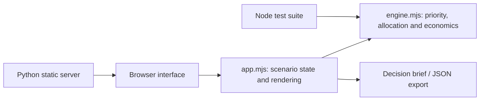

<div align="center">

# ProductLens

### Enterprise Product Strategy & Roadmap Simulator

**Evaluate customer opportunities. Prioritize a constrained backlog. Build a defensible release roadmap.**

  

**[Overview](#overview)** · **[Business scenario](#business-scenario)** · **[How to use](#how-to-use)** · **[Decision model](#decision-model)** · **[Technical architecture](#technical-architecture)**

</div>

---

## Overview

ProductLens is an interactive enterprise **product strategy and release planning** simulation. It illustrates how feature prioritization should consider customer value, expected impact, confidence in the evidence, engineering effort, prerequisites, mandatory delivery work, and limited capacity.

> [!IMPORTANT]
> All data, users, feature demand, confidence, costs, delivery assumptions, compliance deadlines and benefit estimates are **fictional**. ProductLens is a deterministic scenario exploration tool, not a production roadmap system or verified investment business case.

## Business scenario

An insurance business wants to modernize a customer self-service portal. Its product team must decide how to sequence foundational capabilities and customer journeys across **three quarterly releases** while protecting security and accessibility commitments.

The candidate backlog includes:

| Feature | Role in product | Important constraint |
|:--|:--|:--|
| Secure account access | Foundation | Mandatory; predecessor for several experiences |
| Policy lookup and coverage | Self-service | Depends on account access |
| Digital policy documents | Self-service | Depends on policy lookup |
| Add or replace vehicle | Self-service | Depends on policy lookup |
| Billing and payments | Payments | Depends on account access |
| Claims status tracking | Claims | Depends on account access |
| Proactive notifications | Engagement | Depends on policy lookup |
| Accessibility remediation | Compliance | Mandatory in the scenario |

Two mandatory items target **Release 2 or earlier**. Release capacity is initially 32 story points per release, and each feature must fit completely into one release. Dependencies must have shipped **in a previous release**, not merely been selected.

## How to use

1. **Review the business context.** Understand the product outcome, customer friction and delivery constraints.
2. **Prioritize the candidate backlog.** Select or deselect features. The displayed RICE-style score is a comparison aid, not the sole determinant of priority.
3. **Change adoption and evidence confidence.** Compare conservative, base and optimistic assumptions to see how hypothetical benefits change.
4. **Adjust capacity.** Move the per-release story-point sliders to examine different funding or team-capacity constraints.
5. **Inspect the roadmap.** Review the proposed allocation for Releases 1–3, the remaining backlog, missing prerequisites and compliance warnings.
6. **Review estimated economics and governance.** Compare implementation cost and *gross illustrative annual feature benefit*. Export the decision brief or JSON scenario.

### What the simulator deliberately does *not* do

- It does not automatically promise scope, dates or delivery capacity.
- It does not treat a RICE score as evidence that a feature should be funded.
- It does not count unscheduled backlog as delivered value or cost.
- It does not assume benefits from different features are additive in a real financial business case: customers and interactions can overlap.
- It does not approve compliance, security, accessibility or production readiness.

## Decision model

### Prioritization

A feature's comparative score is:

\[\text{Score} = \frac{\text{Reach} \times \text{Impact} \times \text{Confidence}}{\text{Effort in points}}\]

Mandatory features are placed ahead of optional features. Within each group, the model considers scores and feature dependencies. The result is a **planning heuristic**, not a globally optimal portfolio selection solver.

### Roadmap planning

- The planner works from Release 1 through Release 3.
- A dependency must be scheduled **strictly earlier** than its dependent feature.
- A feature cannot be split between releases.
- An infeasible feature remains visible under **Unallocated backlog** with the reason.
- Missing mandatory commitments or late mandatory delivery produce a **RED** assessment. Selected work that cannot fit otherwise produces **AMBER**; an internally feasible roadmap shows **REVIEW**, meaning human approval is still required.

### Financial assumptions

- Illustrative delivery cost = **story points × $11,000 + external integration cost**.
- Hypothetical annual benefit per feature = **reach × adoption × value per use × confidence**.
- The displayed gross annual benefit sums *feature-level estimates*, which may overlap substantially and must be deduplicated before use in a real business case.
- Simple payback is shown for exploring relative assumptions, **not** as a validated financial result. It does not model operating costs, time value of money, timing of adoption or double-counted benefits.

## Technical architecture



| File | Responsibility |
|:--|:--|
| [`ProductLens/engine.mjs`](ProductLens/engine.mjs) | Pure deterministic prioritization, dependency scheduling, cost and benefit calculations |
| [`ProductLens/app.mjs`](ProductLens/app.mjs) | Interactive selections, state changes, dashboard updates and exports |
| [`ProductLens/index.html`](ProductLens/index.html) | Responsive application structure |
| [`ProductLens/styles.css`](ProductLens/styles.css) | Accessible, responsive presentation |
| [`ProductLens/server.py`](ProductLens/server.py) | Lightweight HTTP server; no Python package dependencies |
| [`ProductLens/tests/engine.test.mjs`](ProductLens/tests/engine.test.mjs) | Model regression tests including all 256 feature-selection combinations |
| [`.github/workflows/test.yml`](.github/workflows/test.yml) | GitHub Actions Node.js test workflow |

## Model validation

The included suite comprises **11 automated tests**, covering capacity constraints, mandatory feature deadlines, prerequisites, cost accounting, scenario sensitivity, invalid inputs, state isolation, and all **256 possible subsets of eight features**. This verifies the model's internal rules, not the real-world accuracy of fictional assumptions.

## Run locally (development only)

From the `ProductLens` directory:

```bash
python server.py
```

Open `http://localhost:10000`. A different local port can be selected with the `PORT` environment variable.

Run model tests from the repository root with Node.js 20+:

```bash
node --test ProductLens/tests/*.test.mjs
```

## Deploy to Render

The ZIP uses this repository layout:

```text
README.md
.github/workflows/test.yml
ProductLens/
  index.html
  styles.css
  app.mjs
  engine.mjs
  server.py
  tests/engine.test.mjs
```

Create a Render **Web Service** using the GitHub repository and set:

| Setting | Value |
|:--|:--|
| Language / Runtime | Python 3 |
| Branch | `main` |
| Root Directory | `ProductLens` |
| Build command | `echo "No dependencies"` |
| Start command | `python server.py` |

After deployment, add the **actual Render URL** to your repository's GitHub About section and this README's opening navigation.

## Potential enhancements

Product discovery interviews and evidence mapping; adjustable release-level cost constraints; multi-team skill capacity; feature-level risk scoring; outcome KPI experiments; financial benefits de-duplication; saved scenarios; roadmap comparisons; stakeholder approvals and audit trails.

---

<div align="center">

**ProductLens** · Product discovery, prioritization, roadmap decisions and outcome analysis

<sub>Independent fictional simulation · No confidential organizational or client data</sub>

</div>
